# Building a Serverless REST API Using AWS Lambda and Amazon API Gateway

## 1. Project Overview

This project demonstrates how to build and deploy a serverless REST API using Amazon Web Services (AWS).

The solution uses Amazon API Gateway to receive HTTP requests and AWS Lambda to process them without requiring a dedicated server.

The API accepts a name as a query parameter and returns a personalized JSON greeting.

**Example request:**

`GET /hello?name=Ajara`

**Expected response:**

```json
{
  "message": "Hello, Ajara!",
  "status": "success"
}
```

The project was developed using Python and the AWS Management Console and tested using Postman.

## 2. Project Objectives

- Understand the fundamentals of serverless computing.
- Create and configure an AWS Lambda function.
- Develop a Python-based serverless application.
- Create an HTTP API using Amazon API Gateway.
- Integrate API Gateway with AWS Lambda.
- Configure and deploy an API stage.
- Test a live API endpoint using Postman.
- Document the implementation process.

## 3. Technologies and AWS Services

| Technology / Service | Purpose |
|---|---|
| AWS Lambda | Executes the Python application without managing servers |
| Amazon API Gateway | Creates the HTTP API endpoint and routes requests to Lambda |
| Amazon CloudWatch | Stores Lambda execution logs |
| Python 3.13 | Programming language used for the Lambda function |
| Postman | Tests the deployed API |
| Visual Studio Code | Local project development and documentation |
| GitHub | Version control and project portfolio hosting |

## 4. Architecture

The application follows a serverless architecture.

### Request Flow

1. A client sends an HTTP GET request to the API Gateway endpoint.
2. Amazon API Gateway receives the request through the `/hello` route.
3. API Gateway invokes the configured AWS Lambda function.
4. Lambda processes the incoming query parameter.
5. Lambda returns a JSON response.
6. API Gateway sends the response back to the client.
7. Lambda execution logs are available in Amazon CloudWatch.

### Architecture Diagram

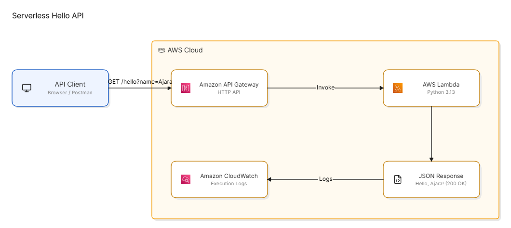

## 5. Project Structure

```text
aws-serverless-apigateway-project/
│
├── architecture/
│   └── serverless-api-architecture.png
│
├── docs/
│
├── events/
│   └── test-event.json
│
├── lambda/
│   └── handler.py
│
├── screenshots/
│   ├── 01-lambda-creation-configuration.png
│   ├── 02-lambda-function-created.png
│   ├── 03-lambda-function-code.png
│   ├── 04-lambda-test-event.png
│   ├── 05-successful-lambda-test.png
│   ├── 06-api-gateway-http-api-option.png
│   ├── 07-api-gateway-lambda-integration.png
│   ├── 08-api-gateway-get-hello-route.png
│   ├── 09-api-gateway-stage-configuration.png
│   ├── 10-api-gateway-review.png
│   ├── 11-api-gateway-created.png
│   ├── 12-api-gateway-stage-created.png
│   ├── 13-api-gateway-prod-stage.png
│   ├── 14-api-gateway-invoke-url.png
│   ├── 15-postman-live-api-test.png
│   └── 16-postman-recreated-api-test.png
│
├── tests/
│
├── .gitignore
└── README.md
```

## 6. Implementation

### Step 1: Create the AWS Lambda Function

Created an AWS Lambda function with the following configuration:

| Configuration | Value |
|---|---|
| Function name | `serverless-greeting-api` |
| Runtime | Python 3.13 |
| Architecture | x86_64 |
| Execution role | Basic Lambda execution permissions |
| AWS Region | US East (N. Virginia) – `us-east-1` |

The Lambda function processes incoming requests and generates a personalized greeting.

### Step 2: Lambda Function Code

The function reads the `name` query parameter and returns a JSON response.

```python
import json

def lambda_handler(event, context):
    query_params = event.get("queryStringParameters") or {}
    name = query_params.get("name", "World")

    response = {
        "message": f"Hello, {name}!",
        "status": "success"
    }

    return {
        "statusCode": 200,
        "headers": {
            "Content-Type": "application/json"
        },
        "body": json.dumps(response)
    }
```

### Step 3: Test the Lambda Function

A test event was created in the AWS Lambda console to simulate an API Gateway HTTP request.

**Test event:**

```json
{
  "version": "2.0",
  "routeKey": "GET /hello",
  "rawPath": "/hello",
  "rawQueryString": "name=Ajara",
  "queryStringParameters": {
    "name": "Ajara"
  },
  "requestContext": {
    "http": {
      "method": "GET",
      "path": "/hello"
    }
  },
  "isBase64Encoded": false
}
```

The Lambda function executed successfully and returned:

```json
{
  "statusCode": 200,
  "headers": {
    "Content-Type": "application/json"
  },
  "body": "{\"message\": \"Hello, Ajara!\", \"status\": \"success\"}"
}
```

### Step 4: Create the API Using Amazon API Gateway

An HTTP API was created in Amazon API Gateway and integrated with the existing Lambda function.

The API was configured with the following settings:

| Configuration | Value |
|---|---|
| API name | `serverless-greeting-api` |
| API type | HTTP API |
| Integration | AWS Lambda |
| Integrated function | `serverless-greeting-api` |
| Route | `GET /hello` |
| Stage | `prod` |
| AWS Region | `us-east-1` |

The API Gateway integration connects the HTTP route to the Lambda function, allowing incoming requests to trigger the serverless application.

### Step 5: Recreate and Deploy the API

The original API Gateway resource was deleted and subsequently recreated. The new HTTP API was configured to use the existing Lambda function.

The recreated API retained the same route and stage configuration:

- Route: `GET /hello`
- Stage: `prod`
- Integration: `serverless-greeting-api`

The new API Gateway Invoke URL is:

**API Gateway Invoke URL:**

```text
https://rv4qjf6w51.execute-api.us-east-1.amazonaws.com/prod
```

**Complete API endpoint:**

```text
https://rv4qjf6w51.execute-api.us-east-1.amazonaws.com/prod/hello
```

**Personalized greeting endpoint:**

```text
https://rv4qjf6w51.execute-api.us-east-1.amazonaws.com/prod/hello?name=Ajara
```

The previous API Gateway endpoint is no longer in use.

## 7. Testing the Live API

Postman was used to test the recreated API Gateway endpoint.

Two GET requests were performed to verify the default and personalized greeting functionality.

### Test 1: Default Greeting

| Test Configuration | Value |
|---|---|
| HTTP method | GET |
| Endpoint | `/prod/hello` |
| Expected response | `Hello, World!` |
| Actual result | Successful |
| HTTP status | 200 OK |

**API response:**

```json
{
  "message": "Hello, World!",
  "status": "success"
}
```

### Test 2: Personalized Greeting

| Test Configuration | Value |
|---|---|
| HTTP method | GET |
| Endpoint | `/prod/hello?name=Ajara` |
| Expected response | `Hello, Ajara!` |
| Actual result | Successful |
| HTTP status | 200 OK |

**API response:**

```json
{
  "message": "Hello, Ajara!",
  "status": "success"
}
```

Both tests were successful. The API received the requests, invoked the Lambda function, processed the query parameters, and returned the expected JSON responses.

## 8. Project Screenshots

The following screenshots document the AWS configuration, deployment, and testing process.

### 8.1 AWS Lambda Setup

**Lambda function creation and configuration**

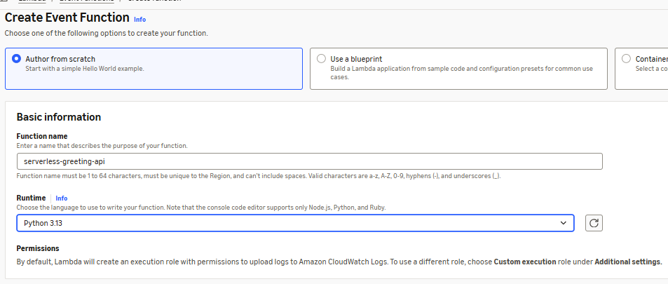

**Lambda function successfully created**

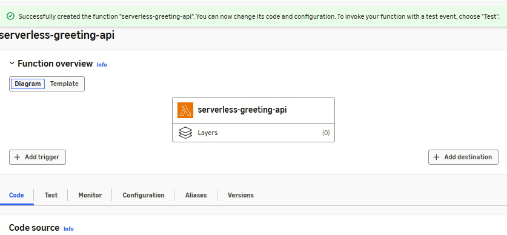

**Lambda function code**

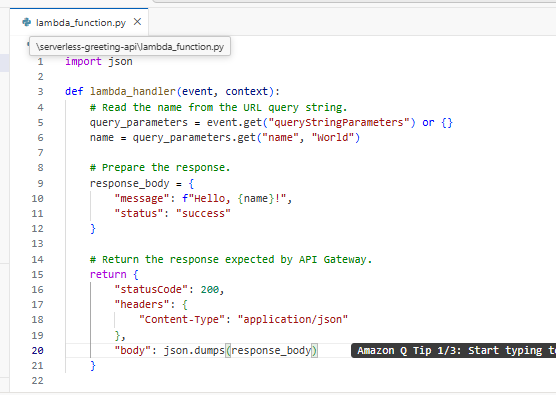

### 8.2 Lambda Testing

**Lambda test event configuration**

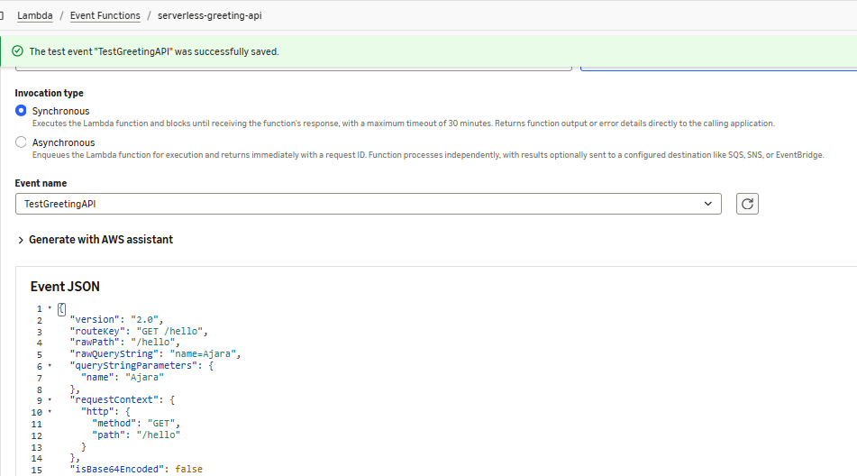

**Successful Lambda execution**

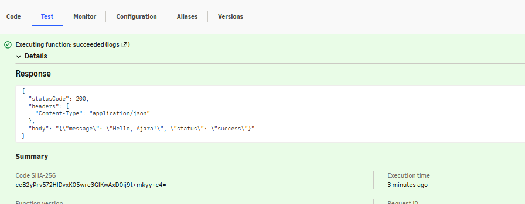

### 8.3 Amazon API Gateway Configuration

**HTTP API option**

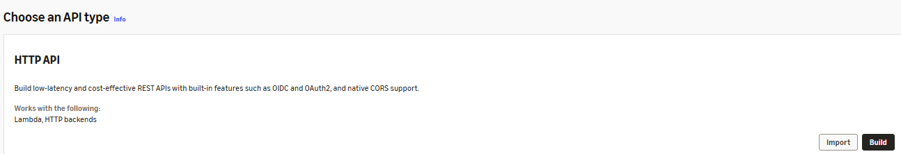

**Lambda integration configuration**

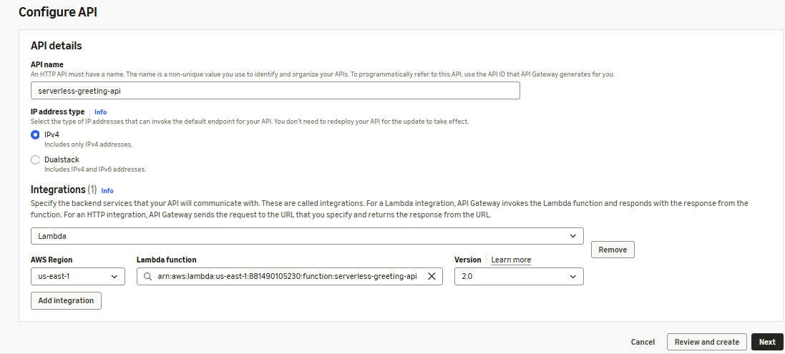

**GET /hello route configuration**

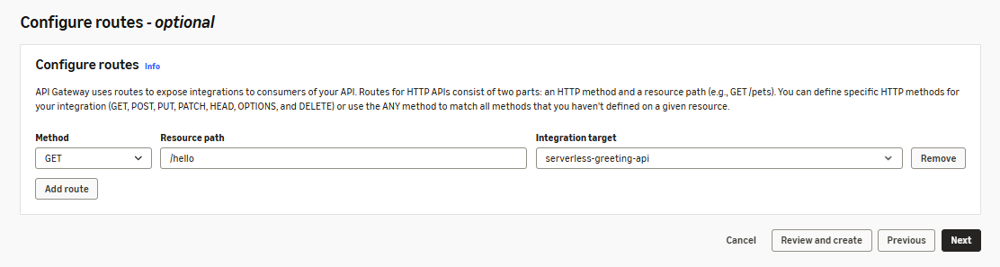

**API stage configuration**

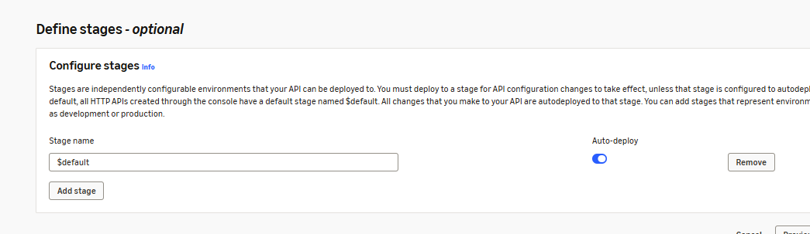

**API review before creation**

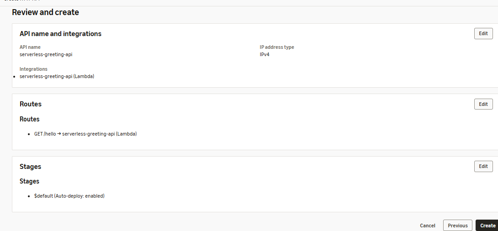

### 8.4 API Deployment

**API successfully created**

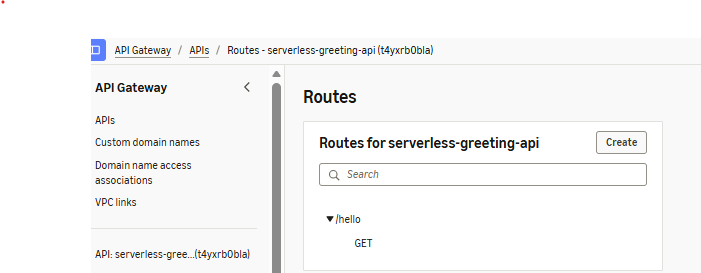

**API stage created**

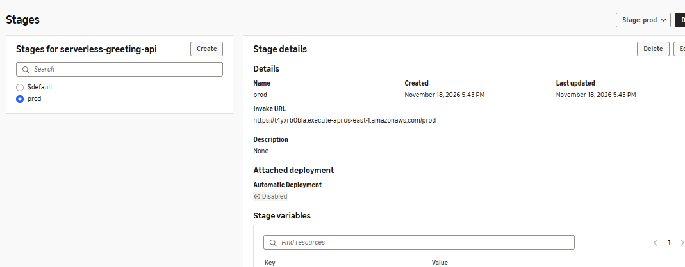

**Production stage configuration**

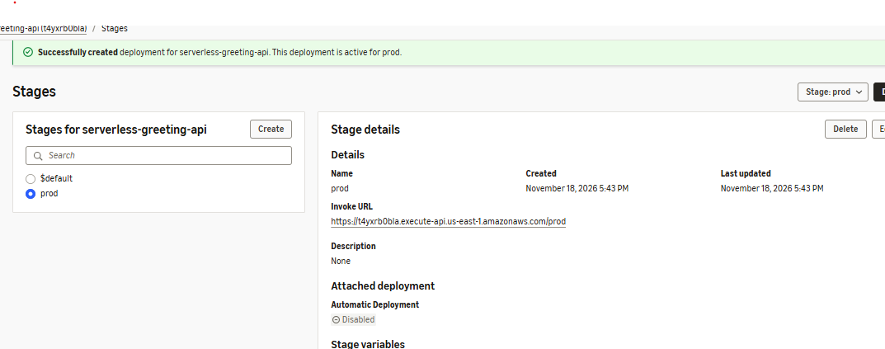

**Original API Gateway Invoke URL**

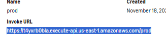

### 8.5 Live API Testing

**Original API test**

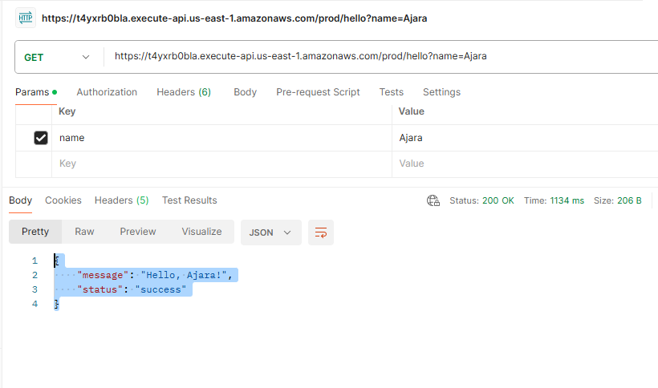

**Successful test of the recreated API Gateway**


## 9. Key Learnings

Through this project, I gained practical experience in:

- Creating and configuring AWS Lambda functions.
- Writing and deploying a Python serverless application.
- Understanding how API Gateway integrates with Lambda.
- Creating HTTP API routes and deployment stages.
- Passing query parameters to a Lambda function.
- Returning structured JSON responses.
- Testing a deployed API using Postman.
- Understanding the role of CloudWatch in Lambda monitoring.
- Recreating an API Gateway resource and reconnecting it to an existing Lambda function.
- Organizing and documenting a cloud project for a technical portfolio.

## 10. Cost Considerations

This project uses AWS serverless services to avoid managing continuously running application servers.

The main services have usage-based pricing:

- AWS Lambda charges depend on requests and execution duration.
- Amazon API Gateway charges depend on API requests and data transfer.
- Amazon CloudWatch may incur charges for log ingestion and storage.

Actual costs depend on account eligibility, usage, and current AWS pricing. AWS Billing should be monitored to track usage and charges.

## 11. Future Improvements

Possible improvements include:

- Add additional API routes.
- Implement input validation and error handling.
- Introduce API authentication and authorization.
- Expand automated unit testing.
- Use AWS SAM or Terraform for infrastructure as code.
- Improve monitoring and alerting using CloudWatch.
- Add Amazon DynamoDB for persistent data storage.

## 12. Conclusion

This project demonstrates how AWS Lambda and Amazon API Gateway can be used together to build and deploy a functional serverless API.

By completing this implementation, I gained practical experience in developing a Python-based Lambda function, configuring API Gateway integrations, deploying an HTTP API, and testing live endpoints using Postman.

The recreation of the API Gateway also provided practical experience in restoring an API endpoint and reconnecting it to an existing Lambda function.

The project provides a foundation for exploring more advanced serverless application development and AWS cloud engineering practices.